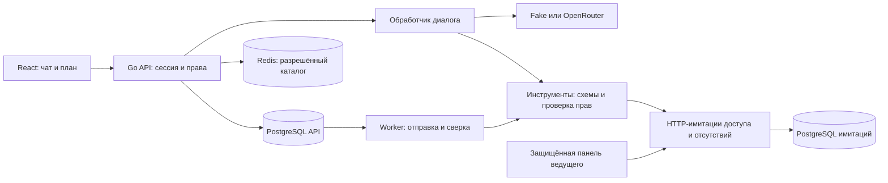

# Архитектура

Реализация следует утверждённому [design.md](../openspec/changes/build-onboarding-prototype/design.md). Прототип работает с синтетическими профилями и демонстрационными регламентами. Решения и альтернативы зафиксированы в [ADR](adr/).

## Компоненты и границы

| Компонент | Реализация |
|---|---|
| Интерфейс | React/TypeScript, TanStack Query и Router, Zustand, Zod; чат, формы, карточки, статусы и план |
| API | Go: непрозрачные cookie-сессии, проверка Origin, серверная авторизация, типизированные ответы |
| Диалог | Очередь сообщений PostgreSQL, сохраняемые уточнения и намерения, поиск разрешённых источников, контакт ответственного |
| Действия | Версионированная карточка → явное подтверждение → неизменяемая попытка → job → результат сервиса |
| Имитации | Отдельный HTTP-процесс, БД и пользователь PostgreSQL; доступ и отгул, идемпотентность, статусы, панель сбоев |
| Хранилища | PostgreSQL: история, профиль, план, карточки, попытки, задания, события; Redis: кэш справочников |

API не читает БД имитаций. HTTP-клиент использует сервисный секрет и проверенного сервером actor_id. Переход на корпоративный сервис требует нового адаптера с сохранением типизированных исходов, проверки полномочий и контракта идемпотентности. Это MCP-подобные инструменты с явными схемами, а не публичный MCP-сервер.

## LLM и источники

`agent.Provider` отделяет распознавание намерения и ответ от поставщика. `LLM_PROVIDER=fake` даёт детерминированное демо без сети. Для `openrouter` нужны `LLM_MODEL` и `OPENROUTER_API_KEY`; конкретная модель не фиксируется. См. [ADR 0010](adr/0010-openrouter-provider.md). Реальная модель в приёмочном прогоне пока не проверялась.

В промпт попадают только разрешённые проекции профиля, плана, документов и каталога. Перед выдачей ответа область прав проверяется повторно; история с источниками фильтруется по текущим правам. Ссылки ведут на авторизованный маршрут документа. При сбое поиска бот сообщает о недоступности; при сбое LLM доступны формы и разрешённые ссылки. Отправка сервисного действия не зависит от свободного текста модели.

## Подтверждения и восстановление

Правка карточки создаёт новую версию и TTL 24 часа. Подтверждение повторно проверяет профиль, права, параметры и конфликты, затем в одной транзакции создаёт попытку с уникальным operation_key и job. Инструмент мутации дополнительно сверяет сохранённую попытку: произвольный вызов без Authority запрещён.

Worker использует lease и операционные часы. Гарантированная недоступность допускает повтор той же попытки; возможная отправка переводит исход в unknown и требует сверки по прежнему ключу. Новый ключ не создаётся при неизвестном исходе. Расписание сверки сохраняется; исчерпание проверок даёт manual_review. При потере lease старый worker не перезаписывает результат. Проекция объекта монотонна по версии, результат, история и события сохраняются транзакционно. «Заявка создана» и «доступ одобрен» — разные статусы.

Перенос отгула состоит из двух отдельно подтверждаемых действий. Порядок зависит от пересечения дат; сбой или unknown останавливает продолжение. Отмена возможна только до начала отсутствия. Общий календарь используется API и имитацией.

## Права и безопасность

Основная роль — стажёр; наставник, руководитель и HR BP читают только назначенных им стажёров. Сервисные мутации доступны стажёру после даты старта. Фронтенд отображает серверное решение. Смена профиля отменяет запросы, очищает клиентское состояние и отбрасывает поздние ответы.

Очистка чувствительного ввода выполняется до записи и LLM, сомнение переводит пользователя на безопасную форму. Это ограниченный прототип фильтра, не гарантия распознавания всех ПДн. Тесты проверяют корпус медицинских, семейных и секретных данных. Сырые ошибки интеграций не выдаются пользователю; события содержат коды, идентификаторы и длительности без текста и ключей. В стенде используются только синтетические данные.

## Отзывчивость, время и эксплуатация

Сообщения и внешние действия выполняются асинхронно. UI показывает ожидание и опрашивает активные задания; история, карточки и план читаются локально без ожидания LLM/имитации. Таймауты ограничены контекстом. Операционное время обслуживает lease, повтор и измерения; DEMO_NOW фиксирует только бизнес-календарь и периоды онбординга.

Docker Compose запускает frontend, API, имитации, PostgreSQL и Redis с readiness-проверками. Полный demo-reset останавливает обработчики до очистки обеих БД и Redis; при частичном сбое обработчики остаются остановленными до повторного согласованного сброса. Скрипт не предназначен для production.

События и SQL-отчёт описаны в [metrics.md](metrics.md). Kafka, Grafana и корпоративная SSO в прототип не включены: потребуются адаптеры и отдельное решение для внедрения. Проверки, измерения и ограничения находятся в [verification/WORK_STATE.md](verification/WORK_STATE.md).

## Наблюдаемый маршрут и рабочее пространство

Редизайн добавляет устойчивый журнал runs/links/events в PostgreSQL (миграции 005/006), серверную безопасную проекцию и API `/api/executions`. Подробности корреляции, атомарности, lease, пагинации, деградации и отката — [контракт маршрутов](execution-routes.md), решение — [ADR 0011](adr/0011-execution-journal.md). Карта не управляет бизнес-операциями и не меняет правила трёх сценариев.

В React один координатор TanStack Query восстанавливает активные и связанные запросы, опрашивает только выполняемую работу раз в секунду и игнорирует старые поколения сессии. Компактная карта, подробности и выбранный пользователем локальный маскот используют один снимок. Ожидание подтверждения, ожидание сервиса, отказ, ошибка и unknown различаются; создание заявки отделено от согласования. [Дизайн и компоненты](design/buddy-experience.md), [свежие доказательства](verification/redesign/README.md).
