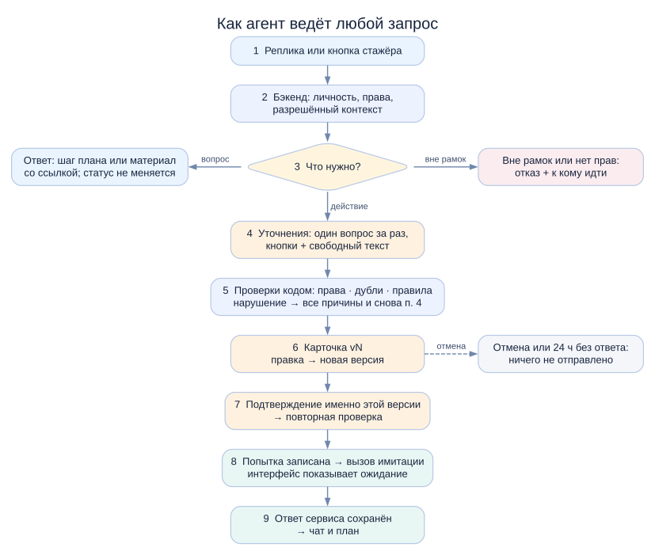
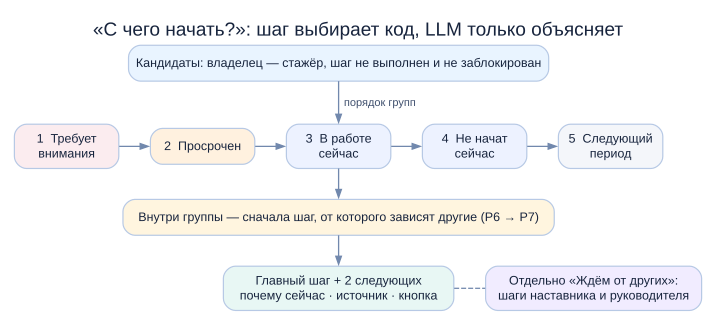
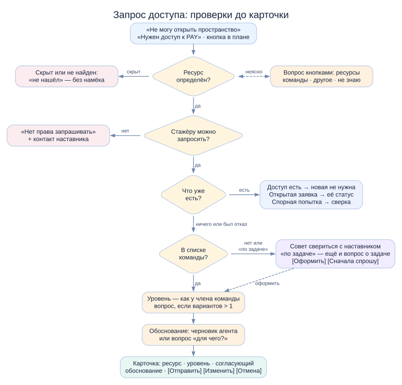
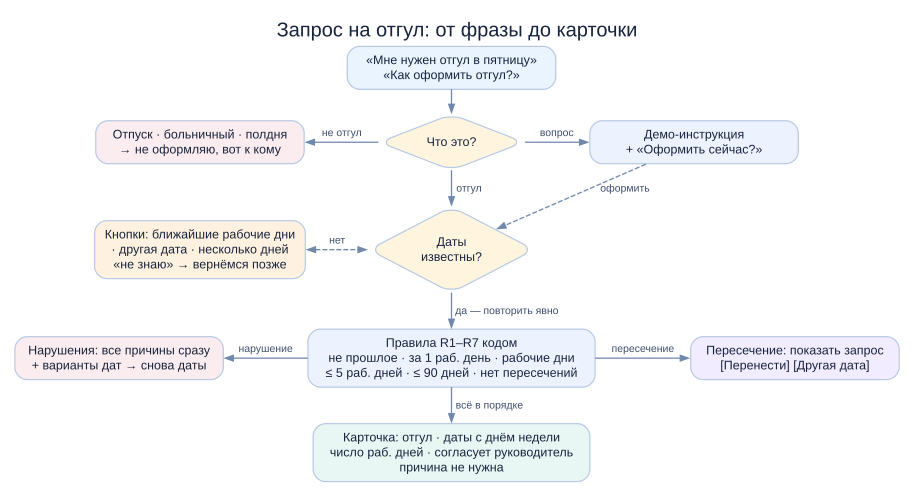
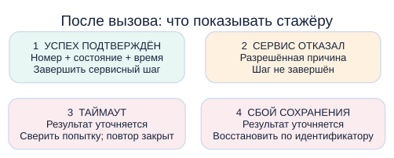
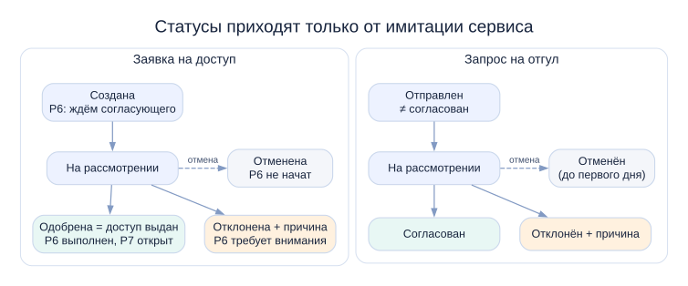

# AI-buddy: сценарии диалога за 5 минут

Как агент ведёт стажёра от первой реплики до результата в трёх сценариях: какие вопросы задаёт, что проверяет, что показывает и чем заканчивается каждый путь. Это краткая версия; подробные маршруты, все ветвления и примеры диалогов — в файлах сценариев.

[Общие механизмы](00-common.md) · [Ориентирование](01-orientation.md) · [Доступ](02-access-request.md) · [Отгул](03-time-off.md) · [Другие ситуации](90-backlog.md) · [Видение](../vision/short-read.md)

**Почему эти сценарии.** По данным организаторов, в первые 2–3 месяца стажёр забирает у наставника около 5 часов в неделю. Самая частая тема — организационная: доступы, оборудование, документы. До первой самостоятельной задачи проходит около 2 недель, адаптация длится около 2 месяцев, чек-листом довольны 68% стажёров. Три сценария бьют в эти точки: следующий шаг вместо статичного чек-листа, доступ без похода к наставнику, отгул без лишних вопросов руководителю. Метрики и план проверки — в [metrics.md](../metrics.md).

## Общие правила диалога

**Что агент знает, а что спрашивает.** Профиль, команду, период адаптации, план, контакты, каталог ресурсов и статусы заявок агент получает из системы и стажёра о них не спрашивает. Спрашивает только то, чего системе не узнать: какой ресурс, какой уровень доступа (если вариантов несколько), какие даты. Причину отсутствия и медицинские сведения не спрашивает никогда.

**Уточнения.** Один вопрос за раз, вероятные варианты — кнопками, всегда можно ответить текстом. Понятое агент повторяет явно: «пт, 13 ноября, 1 рабочий день». На «не знаю» объясняет, где взять ответ, и ничего не создаёт. После двух непонятных ответов подряд — только кнопки и контакт человека.

**Карточка и подтверждение.** Любое действие, меняющее состояние сервиса, проходит через карточку с итоговыми параметрами. Её можно править полями или фразой в чат; каждая правка — новая версия, и подтверждать нужно заново. Черновик ждёт 24 часа, пока стажёр задаёт другие вопросы. При подтверждении бэкенд заново проверяет права, параметры и дубли.

**Права.** Скрытое не раскрывается: скрытый ресурс выглядит как несуществующий. Видимое, но запрещённое — отказ с контактом. Закрытые данные не попадают в контекст LLM.

**Без LLM.** План, статусы и карточки работают. Доступ и отгул оформляются кнопочными формами с теми же проверками. «С чего начать?» отвечает шаблоном: шаг всё равно выбирает код.

**Вне рамок.** Командировка, отпуск, больничный, зарплата, «напиши код» — вежливый отказ и к кому идти: куратор, наставник или руководитель.

## Сценарий 1. Ориентирование

Стажёр спрашивает «С чего начать?», ищет инструкцию или хочет понять, к кому идти. Следующий шаг выбирает код по жёсткому порядку, LLM только объясняет выбор. Ответ по материалам строится только из разрешённых документов команды, со ссылкой и пометкой «демо». Устаревший документ не пересказывается как правило. Текст документа — данные, а не команда. Если инструкции нет, агент так и говорит и называет ответственного. Ответ в чате статус шага не меняет: свой шаг стажёр отмечает сам, кнопкой или в чате с подтверждением.

Один и тот же вопрос у стажёров «Платежей» (1-я неделя) и «Поиска» (2-я неделя) даёт разные шаги и разные документы. Чужие материалы не попадают даже в контекст модели.

## Сценарий 2. Запрос доступа

Триггеры: «не могу открыть пространство», «нужен доступ к PAY», кнопка шага плана. До карточки агент сам проверяет, видим ли ресурс, можно ли его запросить, нет ли уже доступа, открытой или спорной заявки. По словам организаторов, стажёру выдают те же доступы, что и остальной команде, поэтому уровни берутся как у члена команды. Если ресурса нет в списке команды, агент советует свериться с наставником, но не запрещает. Данные по стратегии, финансам и планам запусков выдаются «по задаче»: агент всегда спрашивает, для какой задачи нужен доступ. Обоснование агент пишет сам и спрашивает «для чего?» только у ресурса вне плана и вне списка команды.

Согласующий подставляется из каталога: руководитель, владелец ресурса или DevOps. «Заявка создана» не означает «доступ выдан». Одобрение в демо означает выдачу доступа: шаг «Запросить доступ» выполнен, открывается «Изучить пространство». Отклонённую заявку можно подать снова — агент показывает прошлую причину и советует сначала поговорить с согласующим. Отменить можно заявку в статусах «Создана» и «На рассмотрении».

## Сценарий 3. Запрос на отгул

Оформляется только отгул: один день или несколько рабочих дней подряд, без половины дня. На «как оформить?» агент показывает демо-инструкцию и предлагает оформить сейчас. Даты понимаются терпимо («в пятницу», «20-го», «пт и пн»), неясное уточняется кнопками.

| Правило (демо) | Пример нарушения |
|---|---|
| не в прошлом; минимум за 1 рабочий день | «вчера», «сегодня» |
| первый и последний день — рабочие; выходные внутри не считаются | суббота, демо-праздник 31.12 |
| не больше 5 рабочих дней за раз; не дальше 90 дней | 16–24 ноября; 15 марта |
| нет пересечения с активным или спорным запросом | уже есть запрос на 13.11 |

Согласует руководитель. «Отправлен» не означает «согласован». Наставника стажёр предупреждает сам — агент об этом напоминает. Отмена возможна в любом активном статусе, пока не наступил первый день. Перенос — это новый запрос плюс отмена старого. Если даты не пересекаются, сначала создаётся новый запрос, чтобы стажёр не остался без отгула при сбое.

## После отправки

Попытка записывается до вызова; ожидание видно сразу, интерфейс не блокируется. При таймауте или сбое сохранения — «Результат уточняется»: бэкенд сам сверяет попытку по ключу, у стажёра есть кнопка «Проверить сейчас», повтор на тот же объект закрыт. Если сверка не дала ответа — «Нужна ручная проверка» и контакт. Повторное нажатие или вторая вкладка не создают вторую операцию.

В демо статусы меняет ведущий через панель имитации сервиса. Агент узнаёт об изменении при открытии интерфейса или по вопросу стажёра и пишет первым. Если сервис не ответил, план показывает последнее известное состояние и время.

## Что дальше

- Ревью сценариев командой → OpenSpec change: дельта-спеки WHEN/THEN по критериям приёмки из каждого сценария и контракты двух имитаций.
- Восемь открытых вопросов (действия других ролей, хранение чувствительных сообщений, таймауты и сверка и др.) и 19 кандидатов в новые сценарии (оборудование, вопросы по задачам, повестка 1:1, вопрос наставнику через агента, напоминания) — в [90-backlog.md](90-backlog.md).
