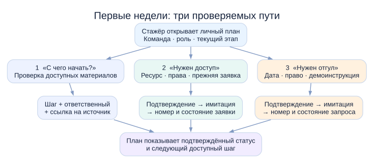
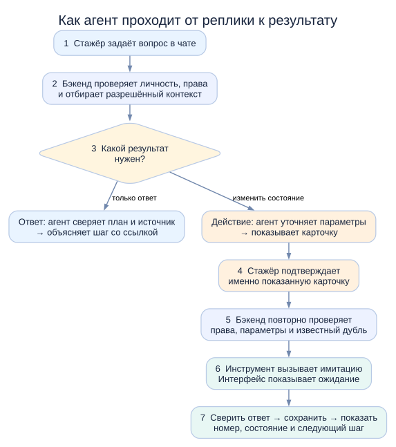
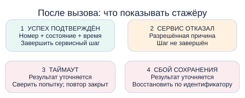
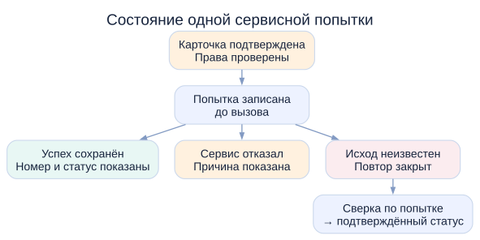
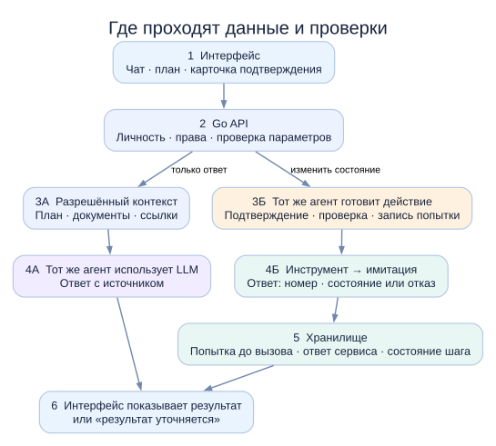

# AI-buddy: видение продукта и пути стажёра

AI-buddy — навигатор первых недель для стажёра любой команды: он помогает понять следующий шаг и довести организационный вопрос до проверяемого результата. Личный план, чат и сервисные действия связаны единым состоянием адаптации. Содержание плана зависит от команды, роли и этапа стажёра.

[Короткая версия](short-read.md) · [Условия кейса](../case/brief.md) · [Критерии оценки](../case/evaluation.md)

## 1. Что просит кейс и почему это важно

Кейс требует прототип помощника для адаптации стажёра: ответы с учётом контекста, выбранные этапы, их состояния и следующие шаги. Можно реализовать один глубокий сценарий или три–пять; хотя бы в одном нужно действие через корпоративный сервис или его имитацию. Действие считается выполненным только тогда, когда сервис вернул результат, а помощник его показал и сохранил.

Ценность решения — в двух изменениях: стажёр меньше теряется между людьми, документами и сервисами, а наставник меньше повторяет организационные инструкции. Обратная связь, обсуждение ожиданий и профессиональное сопровождение остаются за людьми.

По критериям хакатона недостаточно перечислить функции: прототип должен запускаться и позволять пройти каждый заявленный сценарий. Выбраны три разных пути, каждый с проверяемым результатом.

- **Три сценария.** Ориентирование с ответом по источнику, запрос доступа и запрос на отгул проходят от реплики до результата без ручной подмены.
- **Действие через сервис.** В двух сценариях карточка, подтверждение и инструмент приводят к ответу имитации. Номер и статус сохраняются и остаются после обновления страницы.
- **Контекст и прогресс.** План показывает этап, состояние шага, его источник, владельца и следующий переход.
- **Права и внедряемость.** Проверки идут до LLM и перед действием. Отказ на закрытый ресурс и граница адаптера демонстрируют защиту и способ подключения сервиса.
- **Отзывчивость и сбои.** Локальные операции отвечают менее чем за секунду. Ожидание внешнего вызова, таймаут и безопасный повтор проверяются отдельно.
- **Техническое качество.** OpenSpec предшествует коду; тесты и воспроизводимый отчёт показывают покрытие прикладного кода выше 80%.
- **Допуск и защита.** Запуск в чистом окружении по README, продуктовая PDF-презентация и запись сквозного демо входят в сдачу.

## 2. Какие этапы поддерживает план

[Чек-лист из материалов организаторов](../sources/checklist.md) теперь сохранён в репозитории целиком. У него две вкладки: общая для всех стажёров и отдельная для Backend. Основа продукта — общая вкладка; в дальнейшем профильные шаги могут добавляться для соответствующей роли и команды. Это позволяет делать помощника для любого стажёра, не навязывая всем Backend-инструменты.

- **Первая неделя:** знакомство с командой, работа с наставником и запрос доступа в пространство команды. В этот же период наставник или руководитель помогает с чатами, доступами, регулярными 1:1 и обсуждением целей.
- **Вторая неделя:** стажёр изучает документы и инструкции, которыми поделились наставник или руководитель. Инструмент для отслеживания прогресса запрашивает у куратора другой участник адаптации; владелец этого пункта в [конспекте чек-листа](../sources/checklist.md) отмечен как предположение.
- **Позже:** в общей вкладке есть материалы по защите данных, подготовка к экваторной встрече, выпускной и опросы. Они показывают, куда может расширяться план, но не входят в первые две недели прототипа.

В плане у каждого шага указан владелец: стажёр, наставник или другой ответственный. Стажёр не должен видеть задачи другого человека как собственный незавершённый долг. Публичные [истории стажёров и наставников](../sources/habr.md) подтверждают важность доступов в первый день, понятных процессов и регулярного общения с человеком; они описывают опыт прошлых лет, а не текущий обязательный порядок для всех команд. Для прототипа используются синтетические команды и демонстрационные правила.

**Граница покрытия чек-листа.** AI-buddy использует чек-лист как каркас первых недель, но три сценария не закрывают все его пункты:

- **Проработана часть пункта 5:** запрос доступа к пространству команды. Изучение пространства после выдачи доступа остаётся отдельным шагом; созданная заявка его не завершает.
- **Поддержаны частично:** знакомство с командой (пункт 3), работа с наставником (пункт 4) и изучение полученных документов (пункт 7). План показывает людей и следующие шаги, чат помогает найти доступный материал, но продукт не проводит знакомство, не ведёт конспект встреч и не подтверждает изучение всех документов.
- **Отображаются как ответственность человека:** организация чатов, 1:1 и целей, получение методички и инструмента прогресса (пункты 1, 2 и 6). В прототипе нет действий по добавлению в чаты, назначению встреч или согласованию целей.
- **Вне объёма первых недель:** пункты 8–16 общей вкладки и 32 профильных пункта Backend-вкладки. Другим специализациям нужны собственные материалы; они не представлены в исходном чек-листе. Запрос на отгул взят из [кейса](../case/brief.md), а не из чек-листа.

## 3. Для кого создаётся продукт

**Основной пользователь:** новый стажёр любой специализации. В первые дни он не знает, какие шаги важнее в его команде, где лежат нужные ему инструкции и кому адресовать организационный вопрос.

**Наставник:** помогает стажёру с приоритетами, обратной связью и содержательной работой. Ассистент может подготовить повестку 1:1, но не согласует цели и не оценивает стажёра от лица наставника.

**Руководитель:** задаёт ожидания от стажировки. **HR-партнёр (HR BP):** представитель HR, который участвует в адаптации. Отдельные экраны для них в MVP не требуются.

## 4. Как выглядит и работает AI-buddy

Стажёр видит на одном экране план адаптации и чат. **План** отвечает на вопросы «что уже сделано?» и «что дальше?»: показывает ближайшие шаги, их состояние и ответственного. **Чат** помогает разобраться с шагом, найти доступную инструкцию или выполнить разрешённое действие.

План складывается из общих шагов адаптации и шагов конкретной команды. На выбор влияют команда, роль и текущий этап стажёра. Перед ответом система проверяет, какие материалы и действия ему доступны. Поэтому один и тот же вопрос в разных командах может привести к разным инструкциям. Если подтверждённой инструкции нет, помощник так и сообщает.

**Пример связи плана и чата.** В плане есть шаг «Запросить доступ» со статусом «не начат». Стажёр пишет в чат, что не может открыть пространство команды. Помощник уточняет ресурс, проверяет право и наличие прежней заявки, затем показывает карточку запроса. После подтверждения сервис-имитация возвращает номер. Этот номер появляется в чате и плане; шаг меняет состояние на «заявка создана». Доступ пока не считается выданным, поэтому план предлагает другой доступный шаг.

У каждого шага видны владелец, последнее подтверждённое состояние, его источник и доступное действие. Текст помощника сам по себе не меняет статус. Если проверить актуальность состояния не удалось, план показывает последнее известное состояние и время его получения.

## 5. Три сценария первых недель

Три сценария закрывают разные задачи стажёра: понять, что делать; устранить блокер с доступом; оформить организационный вопрос. В каждом есть проверяемый результат. Подготовка повестки 1:1 остаётся возможным развитием, но не входит в заявленные три сценария.

### Сценарий 1. Понять следующий шаг и найти инструкцию

**Запрос стажёра.** «С чего начать сегодня?» или «Где инструкция к инструменту из моего плана?»

**Путь.** Стажёр открывает план и задаёт вопрос. Бэкенд получает его команду, роль, этап адаптации и текущие задачи, затем отбирает только доступные документы. Помощник объясняет, почему конкретный шаг актуален, называет ответственного и даёт ссылку на источник. В плане остаются видны состояние задачи и следующий переход. Ответ в чате сам по себе не отмечает задачу выполненной.

**Проверки.** Нельзя подставлять в ответ документы другой команды или закрытые сведения. Если для вопроса нет подтверждённого источника, помощник говорит об этом и показывает доступный контакт. Если LLM не отвечает, план остаётся доступным, а пользователь видит ошибку ответа без выдуманной инструкции.

**Граница готовности.** Для двух синтетических стажёров из разных команд один и тот же вопрос приводит к разным разрешённым материалам; для каждого показаны актуальный шаг, его источник и ответственный. Закрытый документ не попадает в контекст модели и ответ.

### Сценарий 2. Запросить доступ к рабочему пространству

**Запрос стажёра.** «Не могу открыть пространство команды. Как получить доступ?»

**Основание.** В [общем чек-листе](../sources/checklist.md) стажёру предписано запросить доступ к пространству своего кластера или команды в первую неделю. Готовый сервис заявок на доступ и его API в материалах не описаны. Здесь предлагается собственная имитация такого сервиса; её операция и поля будут определены в OpenSpec до реализации.

**Путь.** Помощник уточняет, о каком ресурсе речь. Бэкенд проверяет право стажёра видеть ресурс и создать запрос, а также известные сведения о доступе и прежних заявках. Если запрос нужен, интерфейс показывает карточку с точными параметрами. Стажёр может изменить её или отменить. Только после явного подтверждения бэкенд повторно проверяет права и передаёт запрос инструменту. Имитация возвращает результат; номер и состояние сохраняются и появляются в чате и плане.

**Результат.** «Заявка создана» означает, что запрос принят сервисом. Фактический доступ остаётся отдельным состоянием и не объявляется выданным без подтверждения. При уже открытой заявке показывается её доступный статус вместо создания новой.

**Сбой и отказ.** При запрете по правам вызова сервиса нет. При ошибке сервиса показывается отказ без изменения статуса доступа. Если результат вызова неизвестен, новая отправка блокируется до выяснения исхода; конкретный способ сверки зависит от контракта имитации и не предполагается заранее.

**Граница готовности.** После подтверждения имитация возвращает результат, который сохраняется и остаётся после обновления страницы. Отмена не вызывает сервис; отказ в правах и повтор не создают заявку; неизвестный исход не показывается как успех или неуспех.

### Сценарий 3. Подготовить и отправить запрос на отгул

**Запрос стажёра.** «Мне нужен отгул в пятницу. Как его оформить?»

**Основание.** Это пример из кейса; сервис отсутствий прямо назван среди возможных интеграций. Реальный порядок согласования и формат его API в материалах не приведены. В прототипе используются демонстрационная инструкция и имитация сервиса отсутствий.

**Путь.** Помощник показывает доступную демонстрационную инструкцию и уточняет дату. Бэкенд проверяет право на операцию и корректность данных в рамках демонстрационного процесса. Перед отправкой стажёр видит карточку: какую дату и какой тип отсутствия будет передан сервису. После подтверждения инструмент вызывает имитацию; её ответ сохраняется и отображается в чате и плане.

**Результат.** Видны номер и состояние запроса, полученные от имитации. «Запрос отправлен» не означает «отгул согласован». Помощник не запрашивает причину, медицинские сведения или другие чувствительные данные.

**Сбой и отказ.** Неполная дата приводит к уточнению до карточки. Отмена оставляет план без изменений. При запрете по правам вызова нет. Ошибка или неизвестный исход сервиса обрабатываются по тем же правилам, что и в сценарии доступа.

**Граница готовности.** Стажёр проходит путь от вопроса до сохранённого ответа имитации. После обновления страницы видны номер, состояние и время; отказ и таймаут не превращаются в сообщение о согласовании отгула.

### Проверка сценариев на сложных случаях

- **Ориентирование, другой профиль.** Стажёр из команды А и стажёр из команды Б задают один вопрос. Каждый получает свой шаг и разрешённый источник; ссылка команды Б не присутствует даже в контексте модели для команды А.
- **Ориентирование, источник устарел.** Если материал не подтверждён или недоступен, помощник не воспроизводит его как правило. В интерфейсе виден ответственный человек и объяснение, что источник не найден.
- **Доступ, права изменились после показа карточки.** Подтверждение не обходит повторную проверку. Инструмент не вызывается, закрытые сведения не раскрываются.
- **Доступ, две открытые вкладки.** Повторное подтверждение одной операции не создаёт два запроса. Показывается уже известная попытка и её последнее подтверждённое состояние.
- **Отгул, дата не уточнена.** Карточка не создаётся, пока не известна дата. Помощник уточняет её без запроса причины отсутствия или медицинских сведений.
- **Оба действия, потеря ответа.** После таймаута интерфейс показывает неизвестный исход и блокирует повтор до сверки. При сбое локального сохранения состояние восстанавливается по зафиксированной попытке; текст «не отправлено» не появляется без проверки.

## 6. Как агент обрабатывает вопрос и действие

{ width=90% }

Сначала бэкенд устанавливает пользователя и отбирает разрешённый контекст. Агент помогает понять намерение. Для вопроса он формирует ответ со ссылкой на источник; для действия показывает карточку и ждёт подтверждения. Перед вызовом инструмента права и параметры проверяются ещё раз. Источник истины о выполнении действия — результат сервиса и его сохранённая запись, а не текст LLM.

### Четыре исхода вызова сервиса

{ width=95% }

> **1. Сервис подтвердил успех, результат сохранён.** Показать номер, состояние и время. В плане отметить именно результат, который вернул сервис: созданную заявку или запрос на отгул, но не выданный доступ и не согласованный отгул.

> **2. Сервис явно отказал.** Показать разрешённую к раскрытию причину. Не переводить задачу в успешное состояние; предложить исправить данные или обратиться к ответственному, если это предусмотрено демонстрационным процессом.

> **3. Таймаут: исход неизвестен.** Показать «Результат уточняется» и заблокировать слепой повтор. Предлагаемый контракт имитации связывает отправку с ключом попытки и позволяет сверить по нему исход. Если подключённый сервис не поддерживает такую сверку, запрос остаётся в неопределённом состоянии до ручной проверки.

> **4. Сервис подтвердил успех, но локальное сохранение не удалось.** Показать «Результат уточняется». Сохранить доступный идентификатор попытки, восстановить запись по нему и сверить результат сервиса. Только после этого объявить сценарий завершённым. Если идентификатор тоже недоступен, требуется ручная сверка; нельзя утверждать, что запрос не отправлен.

**Правило для исходов 3 и 4:** ни таймаут, ни сбой сохранения не означают «заявка не отправлена». Идентификатор попытки, ключ сверки и процедура восстановления — требования к проектируемой имитации, а не известные возможности API Авито. Их конкретный формат и гарантия хранения должны быть описаны в OpenSpec.

Для этого до внешнего вызова прототип должен надёжно зафиксировать попытку. Если зафиксировать её не удалось, вызов не начинается. После ответа сервиса результат привязывается к той же попытке. Именно эта последовательность позволяет обнаружить и восстановить сбой локального сохранения, не создавая новую заявку.

### Общие пограничные случаи

- **Нет прав.** Проверка до передачи данных LLM и перед вызовом инструмента; закрытый ресурс не раскрывается.
- **Недостаточно данных.** Уточнение до карточки; поля и значения не додумываются.
- **Повторное нажатие.** Повтор не должен создавать вторую операцию. Конкретный механизм защиты от дублей фиксируется в спецификации имитации, а не предполагается существующим в корпоративном API.
- **LLM недоступна.** План и уже сохранённые результаты доступны; действие не считается выполненным из-за текста модели.
- **Документ устарел или содержит инструкцию агенту.** Источник не становится командой для инструмента; ответ ограничен проверенными данными.

## 7. Объём прототипа

В сдачу входят три заявленных сценария: ориентирование и ответ с источником, запрос доступа, запрос на отгул. Все три проходят от реплики стажёра до видимого результата. Два сценария действий используют имитации; отдельные реальные API Авито не требуются. Для проверки зависимости от команды предусмотрены два синтетических профиля с разными разрешёнными материалами.

Ограничение по периоду — первые недели адаптации. Повестка 1:1, командировки, бенефиты и другие операции остаются за пределами трёх заявленных сценариев. Число сценариев само по себе не оценивается; каждый из трёх должен работать целиком.

## 8. Состояния и границы доверия

{ width=90% }

- **Шаг плана:** не начат, в работе, ожидает другого участника, требует внимания, выполнен. Источник каждого перехода указан рядом со статусом.
- **Заявка на доступ:** создана, рассматривается, отклонена или завершена — только если такое состояние вернула имитация. Фактический доступ проверяется отдельно.
- **Запрос на отгул:** отправлен, рассматривается, отклонён или согласован — только по ответу имитации. Отправка не равна согласованию.
- **Неизвестный исход:** результат уточняется; последнее подтверждённое состояние и время остаются видимыми.

Права проверяются на бэкенде до формирования контекста для модели и перед действием. Подтверждение относится к показанным параметрам; изменение карточки требует нового подтверждения. Ответы LLM и тексты документов не меняют состояние заявки и не дают право на операцию.

## 9. Как связаны компоненты и сервисы

{ width=95% }

**1 → 2. Вход и граница прав.** Интерфейс передаёт реплику в Go API. Бэкенд устанавливает пользователя и проверяет право на данные и действие. Закрытые данные дальше не проходят.

**3А → 4А. Путь вопроса.** Бэкенд собирает разрешённые сведения из плана и демонстрационных источников. Агент формирует ответ; LLM помогает сформулировать его, но не получает закрытые материалы. В ответе видна ссылка на источник.

**3Б → 4Б. Путь действия.** После подтверждения карточки Go API повторно проверяет права и параметры, затем фиксирует попытку. Инструмент передаёт запрос в имитацию выбранного сервиса. Интерфейс показывает ожидание внешнего вызова.

**5 → 6. Факт и отображение.** Ответ имитации привязывается к попытке и сохраняется. Интерфейс показывает номер и состояние только после сохранения. При неизвестном исходе или сбое записи он показывает «Результат уточняется» и не разрешает слепой повтор.

**Что задано кейсом:** действие через корпоративный сервис или его имитацию; возможность оформить инструменты в MCP-стиле; показ и сохранение результата; права пользователя; неблокирующее ожидание и обработка сбоя. В кейсе названы сервис отсутствий и пример отгула. [Источник: выжимка кейса](../case/brief.md).

**Что задано правилами проекта:** инструменты с явными входом и выходом, имитации с идентификатором и статусом, таймауты и тесты отказов. [Правила бэкенда](../../backend/AGENTS.md) и [правила имитаций](../../mocks/AGENTS.md).

**Что поддерживают открытые материалы:** [чек-лист](../sources/checklist.md) подтверждает шаги и периоды; [статьи AvitoTech](../sources/habr.md) описывают опыт стажёров и подход внутреннего ассистента к поиску, инструментам и подтверждениям. [Учебное задание AvitoTech](../sources/tech-internship.md) содержит пример API для другого продукта. Оно не задаёт контракт сервиса отсутствий или заявки на доступ.

**Что остаётся проектным решением:** конкретные операции и поля запросов, ключ попытки, способ защиты от дублей, проверка неизвестного исхода и восстановление при сбое сохранения. Реальные эндпоинты, форматы сообщений и возможности нужных корпоративных сервисов в доступных материалах не указаны; в репозитории пока нет реализованных интеграций. Эти контракты должны появиться в OpenSpec до написания кода. Имитации не выдаются за существующие корпоративные API.

## 10. Как проверить пользу

Сначала проверяется работоспособность каждого из трёх сценариев: доля результатов, полученных от имитаций и сохранённых в плане; корректность прав и статусов; ответы по разрешённым источникам; обработка отказов и неопределённых исходов. Отдельно измеряется задержка локальных операций и видимость ожидания внешних вызовов.

Затем продуктовая гипотеза проверяется на 5–8 участниках с одинаковыми заданиями на синтетических данных. Фиксируются время до правильного следующего шага, доля действий, завершённых без подсказки, ошибки интерпретации статусов и организационные обращения к наставнику. Такой тест выявит проблемы интерфейса, но не докажет экономию времени наставника.

После хакатона возможен пилот с сопоставимыми группами и заранее определённым периодом. В нём сравниваются время решения организационных задач, число рутинных обращений к наставнику и качество ответов. Экономия часов не заявляется без измерений.

## 11. Демонстрация трёх сценариев

1. Открыть план синтетического стажёра и спросить «С чего начать?». Показать следующий шаг и источник. Переключить тестовый профиль: ответ и материалы меняются по команде.
2. Спросить о доступе к пространству. Показать уточнение ресурса, проверку, карточку подтверждения, ответ имитации и сохранённый номер. Обновить страницу: заявка видна, фактический доступ не объявлен выданным.
3. Спросить об отгуле. Показать демонстрационную инструкцию, карточку с датой, подтверждение, ответ имитации и статус «запрос отправлен», не «согласован».
4. Показать один отказ в правах и один неизвестный исход без ложного успешного статуса. На схеме объяснить, какие части являются решением прототипа и где заканчивается информация из кейса.

Все три сценария должны запускаться по инструкции в чистом окружении. Видео показывает путь от запроса до результата, но не заменяет работающий прототип.
