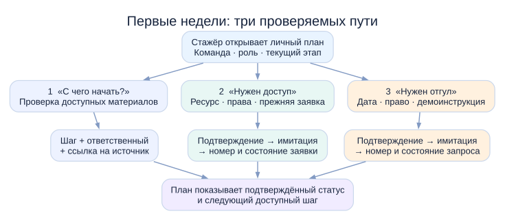
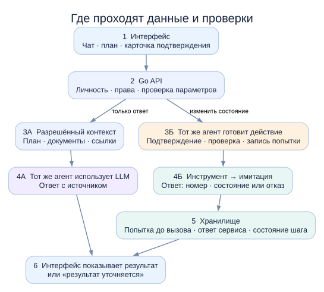
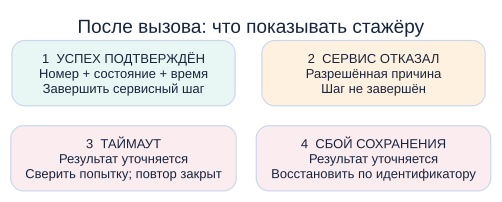

# AI-buddy: видение решения за 5 минут

AI-buddy помогает стажёру любой команды пройти первые недели: понять следующий шаг, найти инструкцию и довести организационное действие до проверяемого результата. План адаптации и чат показывают одно подтверждённое состояние. Действия выполняются после явного согласия стажёра; наставник сохраняет роль в обратной связи и профессиональном развитии.

[Подробный лонгрид](long-read.md) · [Карта пути](cjm.svg) · [Работа агента](agent-flow.svg) · [Компоненты](component-flow.svg) · [Условия кейса](../case/brief.md)

## Проблема и решение

В первые недели стажёр ищет материалы, получает доступы, осваивает инструменты и решает организационные вопросы. Информация распределена между людьми и сервисами; часто непонятно, что делать дальше и подтвердилось ли действие. AI-buddy соединяет личный план с чатом: показывает текущий этап, владельца шага, доступные материалы, состояние и следующий переход. [Чек-лист организаторов](../sources/checklist.md) даёт общий путь для всех стажёров и отдельные Backend-материалы. Прототип реализует части выбранных шагов общей вкладки; профильные материалы и остальные этапы требуют дальнейшего расширения.

Состав шагов зависит от команды, роли и этапа. Ответы опираются на разрешённые демонстрационные источники. Если достоверной инструкции нет, помощник сообщает об этом и предлагает обратиться к ответственному человеку.

## Три сквозных сценария

**1. Ориентирование.** Стажёр спрашивает «С чего начать?» или ищет инструкцию к инструменту. Бэкенд отбирает разрешённые материалы; помощник показывает актуальный шаг, ответственного и ссылку на источник. Для двух синтетических команд ответ различается. Сам ответ не отмечает задачу выполненной.

**2. Запрос доступа.** Общий чек-лист относит запрос доступа в пространство команды к первой неделе. Стажёр сообщает, что не может его открыть. Помощник уточняет ресурс, проверяет права и известные заявки, показывает редактируемую карточку. После подтверждения имитация возвращает номер и статус; они сохраняются в чате и плане. Создание заявки не означает выдачу доступа. Сервис заявок на доступ — **предложенная имитация**: материалы не дают его API.

**3. Запрос на отгул.** Стажёр спрашивает, как оформить отгул. Помощник показывает демонстрационную инструкцию и карточку с датой. После подтверждения имитация сервиса отсутствий возвращает номер и статус. Отправленный запрос не равен согласованному отгулу. Сервис отсутствий и пример отгула приведены в кейсе; его реальные поля и порядок согласования не описаны.

Все три сценария включают проверку прав, ожидаемое состояние интерфейса, обработку отказа и наблюдаемый результат. Для двух действий результат должен сохраняться после обновления страницы.

**Покрытие чек-листа неполное.** Запрос доступа из пункта 5 проработан до заявки, но изучение пространства после выдачи доступа остаётся отдельным шагом. Знакомство с командой, работа с наставником и изучение документов поддержаны планом и ответами частично. Добавление в чаты, назначение 1:1, согласование целей, поздние этапы и Backend-вкладка не выполняются прототипом. Отгул — сценарий кейса, которого нет в чек-листе.

## Как принимается решение

**Агент один в обоих путях.** «Только ответ» означает, что данные сервисов не меняются: например, стажёр спрашивает, как оформить отгул. «Изменить состояние» означает создать запрос или заявку: агент уточняет параметры, показывает карточку и ждёт подтверждения. Один разговор может начаться с объяснения и перейти к действию. LLM помогает агенту понять реплику и сформулировать ответ; права, вызов инструмента и статус проверяет бэкенд.

**Четыре исхода сервисного действия:**

- **Успех подтверждён и сохранён:** показать номер, состояние и время.
- **Сервис явно отказал:** показать причину в разрешённом объёме, оставить шаг незавершённым.
- **Таймаут, исход неизвестен:** показать «Результат уточняется», проверить попытку по проектируемому ключу, заблокировать слепой повтор.
- **Сервис подтвердил успех, сохранение не удалось:** показать «Результат уточняется», восстановить запись по идентификатору попытки и только тогда объявить завершение.

Последние два случая не означают «заявка не отправлена». Ключ и механизм восстановления нужно определить в OpenSpec для имитации: исходные материалы не описывают такие возможности реальных сервисов.

## Что входит в прототип

Первые недели адаптации, два синтетических профиля разных команд, три сквозных сценария, две имитации действий, план и чат с общим состоянием. Отдельные экраны наставника и руководителя не требуются. Подготовка повестки 1:1, командировки и другие сервисные операции остаются за пределами выбранных трёх сценариев.

Прототип должен запускаться в чистом окружении, содержать SDD-спецификации, тесты и воспроизводимый отчёт о покрытии прикладного кода выше 80%. Локальные операции отвечают менее чем за секунду; ожидание LLM и сервисов видно в интерфейсе. Только синтетические данные и явно маркированные демонстрационные инструкции.

## Происхождение сервисных контрактов

Кейс требует действие через сервис или имитацию, допускает инструменты в стиле MCP, требует показать и сохранить результат и соблюдать права. [Чек-лист](../sources/checklist.md) подтверждает этапы, а [публичные статьи AvitoTech](../sources/habr.md) описывают опыт стажёров и внутреннего ассистента. [Учебный API-контракт](../sources/tech-internship.md) относится к другому продукту. Ни один из этих материалов не задаёт эндпоинты сервиса отсутствий, заявки на доступ, ключи попытки или способ сверки таймаута. [Правила проекта](../../mocks/AGENTS.md) требуют описать контракт каждой имитации в OpenSpec до реализации.
